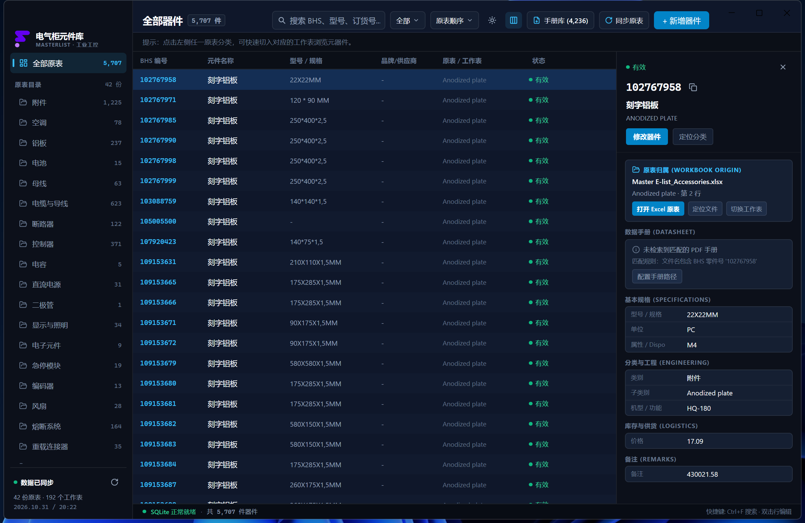

# 电气柜器件库 (MyGo Native)

基于 [MyGo](https://github.com/egoist/mygo) 原生 GPU 渲染引擎（Direct3D 11 / purego）打造的本地电气柜器件库桌面应用。无需 Electron、WebView2 或 Node，运行时为独立原生程序。



## 功能

- **原表目录按原表命名**：左侧列出 `Master E-list_*.xlsx` 时使用原表自身的名字（`Master E-list_Cable&Wire.xlsx` 显示为 `Cable&Wire`），再进入原表分类与工作表，保留 Excel 查表习惯。
- **外观跟随系统**：默认随 Windows 的浅色/深色设置变化，也可在设置中固定为浅色或深色；工具栏按钮可一键在浅色/深色之间切换，设置中可选择"跟随系统"。
- **默认按原表顺序排列**，也可按零件号、元件名称、品牌、型号、最近修改排序并切换升降序。
- **红色零件号即弃用件**：原表用红色标记的零件号，导入时记为"历史"，列表显示"弃用"，详情状态显示为历史。
- **替代零件可跳转**：旧零件号 / 二手零件号 / 关联零件号显示为链接，点击即跳到库中对应的零件；库中没有该零件时复制号码并提示。
- **全文可选中复制**：界面文字均可拖选复制；双击详情中的零件号、型号、名称或来源文件名，自动选中并复制到剪贴板。
- **字号可调**：设置中 80%–150% 调整界面文字大小，默认 100% 即原来的字号；详情栏与列表同步缩放。
- **详情栏常驻**（设置中可关）：没有选中器件时右侧仍保留说明区，列表宽度不跳动。
- **原表只读、不改动原表**：同步时把原表下载到 `data/workbooks` 成为本地副本，导入、打开与定位都使用副本；网络盘或共享盘上的原表不会被锁定或修改。首次启动自动下载，之后按设置的间隔（默认 60 分钟）自动同步最新版本。
- **只同步一层原表目录**：配置的原表目录下若有子文件夹，不进入子文件夹查找表格；PDF 手册则仍会递归遍历多层子文件夹。
- **可排除具体表格**：设置中每行填一个文件名或完整路径（也可填目录排除其下全部原表），被排除的表不导入、不下载副本。
- **密码打开原表**：原表设置了编辑密码时，用设置中保存的密码通过 Excel 打开本地副本（只读、不弹密码框）；设置中可关闭此选项。
- **无示例数据**：Release 自带空库，用"同步原表"从原表导入真实数据。
- 零件号、名称、型号、品牌、订货号模糊搜索，支持常见电气同义词。
- 图纸/手册 PDF 按文件名中的零件号自动关联；可选择常驻 Windows 状态栏（托盘图标），关闭窗口可隐藏到状态栏。
- 手册根目录**递归检索多层子文件夹**，支持 UNC 网络盘与映射盘（如 `Z:\手册`、`\\server\share\pdf`）。
- 同一物料可关联多份手册并逐一查看；文件名相同且大小相同的文件被视为同一份，只显示一次。
- 手册**文件列表**窗口：按文件夹分组浏览、搜索、定位、打开，并提供**手动同步**：只同步用户主动触发的变更，网络波动或共享盘掉线时自动沿用上次索引。
- 手册索引持久化到 `data/pdf-index.json`，再次启动直接读取，不重复遍历网络盘。
- 可选择**只读方式打开 PDF**：打开的是带"只读"标记的私有副本，避免误编辑手册。
- 原表导入适配真实表格的常见布局：合并的 Description 列自动拆分中英文名，列标题顺序不一致时按内容判定，同一行里的两套零件号（套装与其组件、停用件与其替代件）分别入库，`.xls` 旧格式同样导入。
- 只导入 `Master E-list_*.xlsx` / `*.xls` 生产清单；替换清单、图标目录等辅助表不会变成分类。
- Windows User 权限便携运行，全部状态限制在程序目录内。

## 默认目录

- 原表（Excel）：`W:\TD\1_部门资料 Section\TE\2.1_E Parts Database\2.1.2_Master list-总表`
- 数据手册（PDF）：`D:\Knowledge\MM01\Datasheet` 与 `W:\TD\1_部门资料 Section\TE\2.1_E Parts Database\2.1.1_Data sheet`

首次运行会在设置中显示这些默认值，可在设置里替换为其他本地或网络路径。

## 快速运行

Release 中下载 `Masterlist-0.5.0-windows-amd64.zip`，解压后双击 `Masterlist.exe`（或运行 `start.cmd`）。Release 包包含空数据库与 SQLite 运行库，首次运行从原表导入数据。

命令行参数：

```powershell
.\Masterlist.exe -db "D:\data\masterlist.db"
.\Masterlist.exe -query "100917800"
.\Masterlist.exe -settings
```

## 从源码构建

环境要求：Go 1.27.3 或更高版本、Windows 10/11 x64。

```powershell
go mod download
go test ./...
go tool mygo build -skip-build-command -platform windows/amd64
```

产物在 `build/windows-amd64/`：带图标与版本信息的 `Masterlist.exe`，以及当前用户安装包 `masterlist-setup-<version>-amd64.exe`。

若要在开发目录运行，将 `assets/mygo-sqlite3.dll` 放入可执行文件旁；程序也会从内嵌资源释放该运行库。

## 便携目录

```text
Portable/
├── Masterlist.exe
├── mygo-sqlite3.dll
├── icon.png
├── config.json                 # 首次运行后生成
├── README.md
├── start.cmd
└── data/
    ├── masterlist.db           # 器件库（首次运行为空）
    ├── pdf-index.json          # 手册索引缓存
    └── workbooks/              # 原表本地副本（自动同步）
```

- `config.json` 保存手册/原表目录、外观、状态栏、详情栏、原表密码与自动同步间隔等设置。
- 程序不写注册表、不写 `%APPDATA%`，窗口状态和配置均保存在程序目录。

## 数据说明

仓库与 Release 自带的数据库只有表结构、没有任何示例零件。首次运行后通过"同步原表"从配置的原表目录导入；导入规则见 [AI_EXCEL_IMPORT_RULES.md](AI_EXCEL_IMPORT_RULES.md)。

## 技术栈

MyGo `v0.7.3`、Direct3D 11、purego、SQLite、excelize、xlsReader、go-ole、Go embed。
